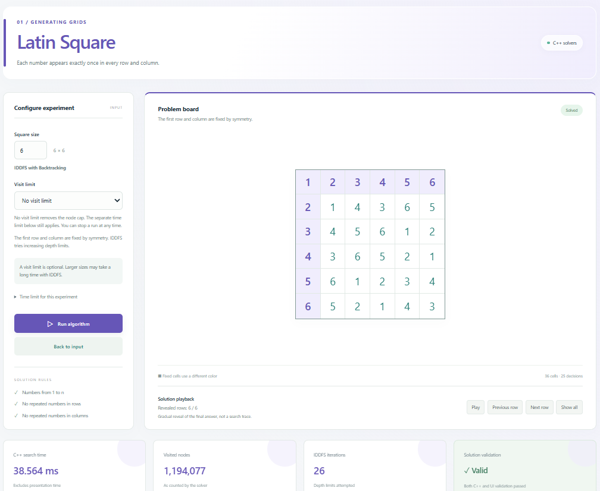
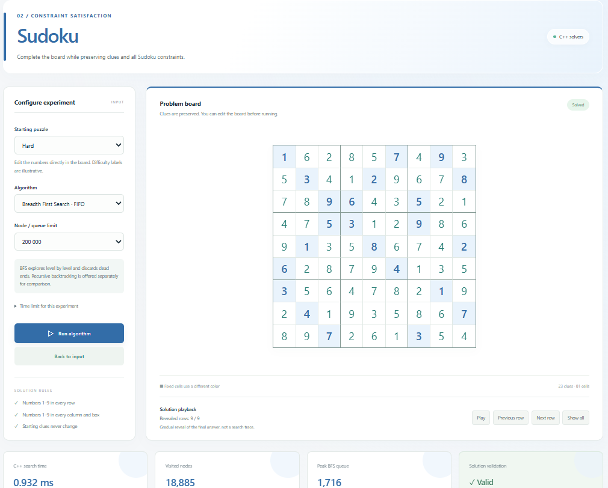

# Uninformed Search Techniques

This project implements three constraint problems in C++17. Each problem is described below using the same five parts: model, representation, objective function, evaluation function and landscape.

| Problem | Main search algorithm |
|---|---|
| Social Golfers | DFS with backtracking |
| Sudoku | FIFO BFS with constraint pruning |
| Latin Square | IDDFS with backtracking |

The search algorithms do not rank branches using a heuristic score. Numeric evaluation functions are used by the separate landscape analysis programs. Validators independently check complete solutions.

## UI Preview

The local **Uninformed Search Techniques** interface runs the C++ solvers and displays their independently validated results. The screenshots below show individual runs; execution times vary by machine and workload.

### Latin Square

A solved 6 × 6 square using IDDFS with backtracking: 26 iterations and 1,194,077 visited nodes. The first row and column are fixed by symmetry.



### Sudoku

The built-in hard puzzle solved using FIFO BFS with constraint pruning: 18,885 visited states and a peak queue of 1,716. Starting clues remain highlighted.



### Social Golfers

A validated 8-week schedule for 32 players in 8 groups of 4, found using general DFS with backtracking. The screenshot shows week 1 of 8; the week controls allow the full schedule to be explored. This run visited 2,179,221,950 nodes and does not establish that 8 weeks is the maximum.


## 1. Social Golfers

### 1.1 Problem model

Given `g` groups, `p` players per group and `w` weeks, let $n = g \times p$. Find a schedule such that:

- Each week has exactly `g` groups of `p` players.
- Every player appears exactly once in every week.
- Every pair of players shares a group at most once across all weeks.

The assignment's instance has `n=32`, `g=8`, `p=4`. For example, a group `[0,1,2,3]` uses six pairs. In later weeks, none of these four players may share a group with another member of that original group.

### 1.2 Representation

The schedule is a **one-dimensional array** of $w \times n$ player identifiers:

```cpp
using Schedule = std::vector<int>;
// index = week * n + group * p + seat
```

Every four entries form a group and every 32 entries form a week in the assignment's instance. Indices start at zero; index `34` is the third seat of the first group in week two.

| Concept | Definition |
|---|---|
| Variable `X[i]` | Player assigned to schedule position `i` |
| Initial domain | `{0,1,...,n-1}` |
| Legal candidates | Players not assigned that week who have not met any current group member |
| Unassigned marker | `-1`, which is not part of the player domain |
| Search state | Partial schedule, available partners, remaining players and current group |
| Goal | Complete schedule satisfying all constraints |

`availablePartners[a]` records who may still meet player `a`. Bit masks speed up the set operations and expand to multiple words above 64 players. The schedule itself remains a single array.

The solver fills one group at a time, choosing its members recursively. The position variables above describe the stored schedule; they do not require a separate search call for every seat.

The first week is fixed to consecutive groups: `[0,1,2,3] [4,5,6,7] ...`. This removes equivalent player labelings without losing feasibility. In week two, `[0,4]` cannot accept `1`, who has met `0`, or `5`, who has met `4`. `[0,4,8,12]` passes the first-week pair checks, although that alone does not guarantee a complete extension.

### 1.3 Objective function

The original optimization objective is:

$$
\max w \qquad \text{subject to all scheduling constraints.}
$$

For `p>1`, each player meets `p-1` new partners per week and has only `n-1` possible partners:

$$
w(p-1) \le n-1
\qquad \Longrightarrow \qquad
w \le \left\lfloor \frac{n-1}{p-1} \right\rfloor
$$

For 32 players in groups of four:

$$
w \le \left\lfloor \frac{32-1}{4-1} \right\rfloor
= \left\lfloor \frac{31}{3} \right\rfloor = 10
$$

A valid ten-week schedule would prove the upper bound is attained. The bound alone does not prove that such a schedule exists. When `p=1`, the pair constraint imposes no upper bound on weeks.

Our solver addresses **fixed-`w` feasibility**: find a valid schedule for the requested weeks. It does not automatically increase `w` to find the maximum.

### 1.4 Evaluation function

For complete candidate schedules that already satisfy weekly participation and group sizes, let $c_S(a,b)$ count the weeks in which players $a$ and $b$ share a group in schedule $S$:

$$
E(S) = \sum_{0 \le a < b < n} \max\bigl(0,\;c_S(a,b)-1\bigr)
$$

A pair appearing once contributes zero, twice contributes one, and three times contributes two. Therefore $E(S)=0$ means a valid solution on this candidate space: every pair meets at most once.

Example with four players in two groups of two:

| | Valid schedule | Schedule with repeated pairs |
|---|---|---|
| Week 1 | `[0,1] [2,3]` | `[0,1] [2,3]` |
| Week 2 | `[0,2] [1,3]` | `[0,1] [2,3]` |
| Penalty | $E(S)=0$ | $E(S)=2$ |

In the second schedule, pairs $(0,1)$ and $(2,3)$ each occur twice, contributing one penalty each.

`landscape.cpp` calculates this numeric penalty. DFS does not calculate it to rank candidates; it checks constraints directly while building the schedule. `golfValid()` instead returns a Boolean and also checks completeness, identifiers and weekly participation. A partial schedule is not a solution just because it has no repeated pairs.

### 1.5 Landscape

The landscape uses complete candidate schedules as states and $E(S)$ as their height. A neighbor swaps two players from different groups in a week after the fixed first week. This preserves group sizes and weekly participation, while the penalty can improve, remain equal or worsen.

There are several useful ways to count candidate schedules:

- Assigning any player to each position gives $n^{wn}$ assignments, including duplicate and missing players within a week. The unassigned marker is excluded from this count.
- Requiring every player exactly once per week gives $(n!)^w$ position-based schedules.
- Ignoring the order of players inside a group and the order of groups inside a week gives the weekly partition count $A$:

$$
A = \frac{n!}{(p!)^g\,g!}
$$

The denominator removes equivalent orderings: $p!$ for each of the $g$ groups, and $g!$ for the group order.

$$
N_{\text{all weeks}} = A^w
\qquad\text{and}\qquad
N_{\text{first week fixed}} = A^{w-1}
$$

Weeks remain distinguishable. These counts still include repeated pairs; they are not counts of valid solutions or visited DFS nodes.

For $g=8$ and $p=4$:

$$
A = \frac{32!}{(4!)^8\,8!}
= 59\,287\,247\,761\,257\,140\,625
$$

| Weeks | Candidate partitions $A^w$ | First week fixed $A^{w-1}$ |
|---|---|---|
| 8 | $\approx 1.526477 \times 10^{158}$ | $\approx 2.574714 \times 10^{138}$ |
| 10 | $\approx 5.365533 \times 10^{197}$ | $\approx 9.050063 \times 10^{177}$ |

The swap neighborhood belongs to the landscape analysis; DFS instead extends partial schedules and backtracks.

The analysis samples random complete schedules, retains the canonical first week and tests one random swap per sample. Measured results are summarized after the three problem descriptions.

### 1.6 DFS with backtracking

**Connection to the code:** `run()` initializes week one; `fillWeek()` starts the next group; `fillGroup()` selects its members. On a failed continuation, the code restores available partners and resets the group entries to `-1`. Necessary feasibility checks and symmetry breaking prune branches without heuristic scoring.

The recursive calls provide the DFS traversal. Restoring the previous state after failure provides backtracking; these are parts of one search algorithm. Bit masks accelerate set operations without introducing a heuristic ranking.

### 1.7 Why bit masks?

Each bit represents one player: `1` means included, `0` means excluded. For 32 players, a set fits in one 64-bit integer. For example, intersecting two sets:

```text
Candidates:       {0, 2, 5}  -> 00100101
Allowed partners: {2, 3, 5}  -> 00101100
Bitwise AND:      {2, 5}     -> 00100100
```

One bitwise AND filters many candidates at once. C++ performs this directly on integer values, reducing the work per search node. This optimizes set operations, while the algorithm remains DFS with backtracking. Larger player sets use multiple 64-bit words; actual speed gains depend on the instance and machine.

**Complexity (DFS, worst case):** time $O(b^m)$; standard search space $O(bm)$, where $b$ is the maximum branching factor and $m$ the maximum search depth; problem-state storage is additional.

## 2. Sudoku

### 2.1 Problem model

Fill a $9 \times 9$ board with digits `1..9` so that:

- Every row contains each digit once.
- Every column contains each digit once.
- Every $3 \times 3$ box contains each digit once.
- All original clues remain unchanged.

For example, an empty cell cannot accept `5` if its row, column or box already contains `5`.

The solver uses **BFS with the general backtracking concept of abandoning unsuccessful paths and exploring alternatives**. Valid assignments are added to a FIFO queue and explored level by level; paths with no legal continuation are discarded. Cells and values follow a fixed order, without heuristic ranking. Complete solutions are independently validated.

### 2.2 Representation

The public board is a **one-dimensional array**:

```cpp
using Board = std::array<int, 81>;
// index = row * 9 + column
```

| Concept | Definition |
|---|---|
| Variables | Initially empty cells |
| Initial domain | `{1,2,...,9}` |
| Legal candidates | Digits absent from the cell's row, column and box |
| Unassigned marker | `0`; fixed clues are not search variables |
| Search state | Compact board, cached masks for 27 units and assignment depth |
| Goal | Complete valid board preserving all clues |

Empty cells are selected in fixed position order and values in ascending order. The compact state keeps queue storage smaller. `containsDigit`, `addDigit` and `removeDigit` isolate bit operations; Sudoku uses bits `1..9` and leaves bit zero unused.

The CLI and UI also offer **Hard+**, a bonus example named `hard_plus`. The original three examples are retained. Measured BFS work with the fixed cell/value order is:

| Example | Clues | Empty cells | Visited states |
|---|---:|---:|---:|
| easy | 30 | 51 | 4,632 |
| medium | 36 | 45 | 69 |
| hard | 23 | 58 | 18,885 |
| hard_plus | 23 | 58 | 117,167 |

The first two names are illustrative and are not ordered by BFS workload. Hard+ is a legal transformation of our existing hard board (row/column reorderings preserving boxes and a digit relabeling), independently checked to have one solution. The transformation changes workload under fixed position-order BFS; it does not establish higher intrinsic or human difficulty. Peak BFS queue length for Hard+ is 14,929 states. No heuristic was added to the delivered solver; the independent uniqueness check was validation only.

### 2.3 Objective function

Find **any complete board satisfying all constraints**. All valid completions are acceptable; the solver does not optimize uniqueness or execution time. On the candidate space below, this can be expressed as minimizing $E(S)$ with target zero.

### 2.4 Evaluation function

Landscape candidates preserve clues and make every row a permutation of `1..9`. The penalty counts repeated digits in columns and boxes:

$$
E(S) = \sum_{c=1}^{9} \left(9-d(C_c)\right)
     + \sum_{b=1}^{9} \left(9-d(B_b)\right)
$$

Here $C_c$ is column $c$, $B_b$ is box $b$, and $d(U)$ counts the different digits in unit $U$.

Each extra occurrence after a digit's first occurrence in a unit contributes one violation. For example, a column with eight distinct digits contributes one. On this candidate space, zero means a valid solution because rows and clues are already correct.

`sudokuSolutionValid()` independently checks the full solution and preservation of clues. The numeric penalty is only for landscape analysis and does not guide BFS.

### 2.5 Landscape

- **State:** complete board preserving clues and valid row permutations.
- **Height:** column and box penalty $E(S)$.
- **Neighbor:** swap two non-clue cells in the same row, preserving clues and row validity.

For valid starting clues with $b$ blanks, the unrestricted clue-preserving space contains $9^b$ assignments. If row $r$ has $k_r$ blanks, its missing digits can be arranged in $k_r!$ ways. The smaller space used by the analysis therefore has:

$$
N = \prod_{r=1}^{9} k_r!
$$

$$
\log_{10} N = \sum_{r=1}^{9} \log_{10}(k_r!)
$$

For the built-in `easy` board, $\log_{10} N \approx 23.3815$, so $N \approx 10^{23.3815}$. Column and box violations are still possible. If no row has two blank cells, no permitted swap neighbor exists.

**Complexity (BFS, worst case):** time and space $O(b^d)$, where $b$ is the maximum branching factor and $d$ the shallowest solution depth; space counts queued states.

## 3. Latin Square

### 3.1 Problem model

Construct an $n \times n$ grid with values `1..n`, each appearing exactly once in every row and column. Unlike Sudoku, there are no box constraints.

Example of a valid $3 \times 3$ square:

```text
1 2 3
2 3 1
3 1 2
```

### 3.2 Representation

The grid uses `std::vector<std::vector<int>>`. Row and column masks cache the values already present.

| Concept | Definition |
|---|---|
| Variables | Cells outside the fixed first row and column: $(n-1)^2$ cells |
| Initial domain | `{1,2,...,n}` |
| Legal candidates | Values absent from the cell's row and column |
| Unassigned marker | `0` |
| Search state | Partial grid, row/column masks and assignment depth |
| Goal | Complete grid with no row or column repetitions |

Fixing the first row and column to `1..n` removes equivalent labelings; it does not exclude the existence of a Latin square. Cells are visited in fixed order and values in ascending order. The implementation supports `n=1..8`.

`containsValue`, `addValue` and `removeValue` isolate bit operations; value one uses bit zero. `place()` and `undo()` update both the grid and its masks.

### 3.3 Objective function

Find **any complete valid Latin square** of the requested size. All valid squares are acceptable. On the analysis space, this is equivalent to minimizing $E(S)$ with target zero.

IDDFS tries depth limits $0,1,\ldots,(n-1)^2$. Each iteration runs the same depth-limited DFS, placing values and undoing failed placements. An optional node budget accumulates across iterations; without one, the search has no visit cap. Backtracking is part of every depth-limited DFS iteration; there is no separate algorithm choice for Latin Square.

### 3.4 Evaluation function

Landscape candidates already have valid row permutations and the fixed first row and column. Define:

$$
E(S) = \sum_{c=1}^{n} \left(n-d(C_c)\right)
$$

Here $C_c$ is column $c$, and $d(C_c)$ counts its different values.

For example, a column with $n-1$ distinct values contributes one violation. Zero is a valid solution on this space. `validate()` independently checks the final square. The penalty does not rank IDDFS branches.

### 3.5 Landscape

- **State:** complete row-permutation grid preserving the fixed first row and column.
- **Height:** column penalty $E(S)$.
- **Neighbor:** swap two unfixed cells within one row, preserving row validity and the fixed cells.

With the first row and column fixed, but without enforcing row permutations, there are $n^{(n-1)^2}$ assignments. Requiring each of the $n-1$ remaining rows to permute its $n-1$ missing values gives the sampled space:

$$
N = \bigl((n-1)!\bigr)^{n-1}
$$

For $n=5$:

$$
N = (4!)^4 = 24^4 = 331\,776 \approx 10^{5.520845}
$$

These candidates can still violate columns. For $n<3$, a row has fewer than two unfixed cells, so no such swap exists.

**Complexity (IDDFS, worst case, $b>1$):** time $O(b^d)$; standard search space $O(bd)$, where $b$ is the maximum branching factor and $d$ the shallowest solution depth; problem-state storage is additional.

## 4. Measured landscape results

Each separate `landscape.cpp` uses [shared/landscape.hpp](shared/landscape.hpp) for sampling and reporting. The search algorithms do not call this analysis. The recorded runs used **1,000 samples, seed 42**:

| Problem and instance | Minimum | Mean | Maximum | Zero-penalty samples | Improving / equal / worsening swaps |
|---|---:|---:|---:|---:|---|
| Golfers, `8 x 4`, 8 weeks | 88 | 107.785 | 132 | 0 | 387 / 232 / 381 |
| Sudoku, `easy` | 34 | 46.386 | 58 | 0 | 394 / 243 / 363 |
| Latin Square, `n=5` | 2 | 6.374 | 11 | 0 | 359 / 307 / 334 |

Full distributions: [Golfers report](outputs/social_golfers_landscape_8weeks.txt), [Sudoku report](outputs/sudoku_landscape_easy.txt), [Latin Square report](outputs/latin_square_landscape_5.txt).

No zero-penalty sample means only that none was observed. It does not prove nonexistence; the search programs have found valid solutions for these cases. One random neighbor per sample does not identify all local minima or plateaus. Penalties use different definitions across problems and should not be compared as a common scale. Exact seeded samples may differ between C++ standard-library implementations.

## 5. Code organization and statistics

```text
problems/{social_golfers,sudoku,latin_square}/
    main.cpp                    input and output
    solver.hpp / solver.cpp     representation and search
    validator.hpp / validator.cpp  independent correctness checks
    tests.cpp                   solver and validator tests
    landscape.cpp               separate analysis
shared/
    common.hpp                  status, statistics, budget, timing and CLI helpers
    landscape.hpp               common sampling and reporting
tests/shared_tests.cpp          shared budget checks
ui/                             local visualization
outputs/                        measured landscape reports
```

Start with `main -> solver -> validator`. For Golfers, follow `golfers -> run -> fillWeek -> fillGroup`; for Sudoku, the FIFO loop is directly in `sudoku()`; for Latin Square, follow `solve -> search`.

Bit masks optimize data representation and checks. They do not introduce heuristic branch ranking. The code uses fixed candidate order or a fixed seeded shuffle, necessary feasibility checks and symmetry breaking. Backtracking restores the previous state after an unsuccessful branch.

`SOLVED` means a solution was found; `UNSAT` means infeasibility was proved for the requested instance; `UNKNOWN` means the budget was exhausted. Latin Square currently signals budget exhaustion through an exception at its API boundary. A valid Golfers schedule for fewer than ten weeks does not prove the maximum number of weeks.

The counters retain their existing meanings:

- `visited`: processed BFS states or DFS entries; Golfers includes auxiliary group-feasibility recursion.
- `generated`: enqueued Sudoku states or committed Golfers groups; Latin Square does not collect this field.
- `backtracks`: reverted assignments/groups. BFS leaves this zero.
- `peak`: maximum BFS queue length, not total memory in bytes.
- `iterations`, `maxDepth`: collected by Latin Square.

The fields are shared, but counts across different problems are not directly interchangeable. Refactor comparisons preserved solutions, statuses and counters; runtime is a separate measurement.

## 6. Build, test and run

Run these commands from the project directory with CMake, Ninja and a C++17 compiler available:

```powershell
cmake -S . -B build -G Ninja -DCMAKE_BUILD_TYPE=Release
cmake --build build
ctest --test-dir build --output-on-failure
```

CMake writes executables to `build/bin`. Supplied executables are in `bin`, which the UI also uses. To update that directory after a build:

```powershell
Copy-Item .\build\bin\*.exe .\bin\ -Force
```

Examples using the supplied executables:

```powershell
.\bin\social_golfers.exe 8 4 3
.\bin\sudoku.exe bfs hard
.\bin\sudoku.exe bfs hard_plus
.\bin\sudoku.exe backtracking hard
.\bin\latin_square.exe 5                # No visit limit
.\bin\latin_square.exe 7 2000000        # Optional visit limit

.\bin\social_golfers_landscape.exe 8 4 8 1000 42
.\bin\sudoku_landscape.exe easy 1000 42
.\bin\latin_square_landscape.exe 5 1000 42
```

Every solver and landscape executable accepts `--test`. Landscape arguments are:

- Golfers: `groups players/group weeks [samples [seed]]`; defaults `8 4 8 1000 42`.
- Sudoku: `[easy|medium|hard|hard_plus|81 digits [samples [seed]]]`; defaults `easy 1000 42`.
- Latin Square: `[n [samples [seed]]]`; defaults `5 1000 42`.

Golfers CLI arguments are `groups players/group weeks [node limit [seed]]`. Its default node budget is 2,000,000; the recorded general-search eight-week result used a separate unlimited-budget runner. Large cases can therefore return `UNKNOWN` in the CLI or UI even when a valid schedule exists. Sudoku accepts an optional node limit after the puzzle. Latin Square accepts `n [visit limit]`; the limit defaults to `0` (no visit limit). A positive limit is optional and accumulates across IDDFS iterations.

## 7. Local UI

With Node.js installed, run from the project directory:

```powershell
cd ui
npm start
```

Open [http://127.0.0.1:8787/](http://127.0.0.1:8787/). Keep the terminal open; press `Ctrl+C` to stop.

The UI runs the C++ programs from `bin`, displays validated solutions, and includes interactive Search Trees with PNG downloads. No `npm install` is needed to run the supplied UI.
